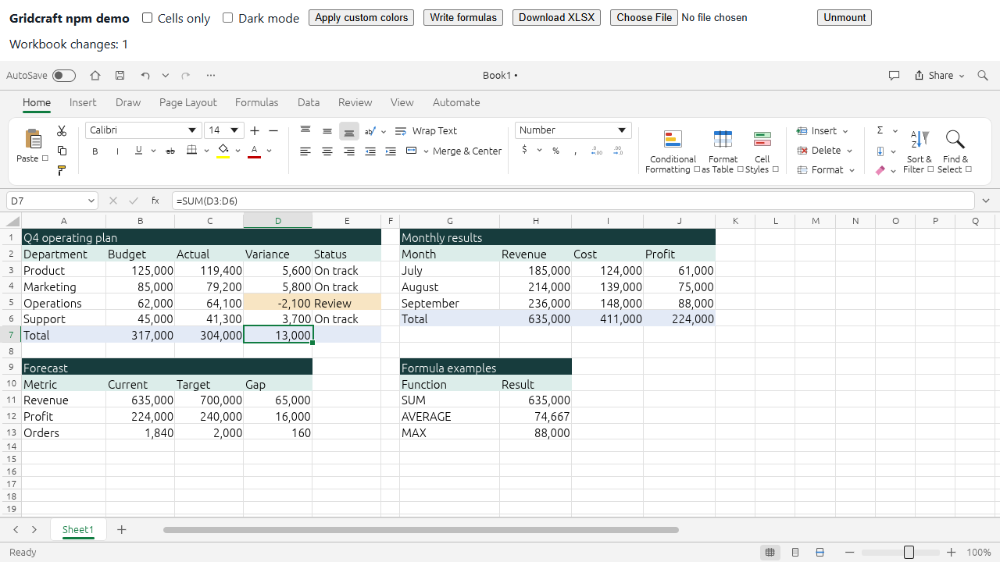
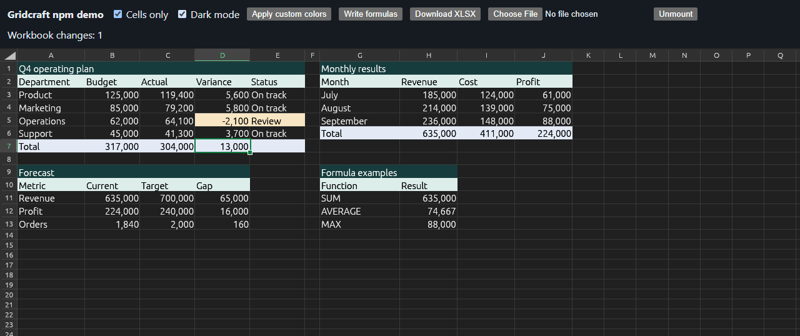

# Gridcraft Embed

[npm](https://www.npmjs.com/package/gridcraft-embed) · [GitHub](https://github.com/PonyTrap420/gridcraft-embed) · [Upstream](https://github.com/storytold/gridcraft)

An **unofficial prototype npm package** that embeds the existing Gridcraft spreadsheet UI directly in a React app. Rust owns the workbook and renders into a canvas; JavaScript exposes the existing command engine. No iframe or spreadsheet backend is required.



<details>
<summary>Dark mode and cells-only preview</summary>



</details>

## Install

```bash
npm install gridcraft-embed
```

This is an unofficial prototype, independently packaged from Gridcraft. The exact engine release and source commit are recorded in [UPSTREAM.md](UPSTREAM.md). The npm wrapper uses its own version numbers.

## Automatic upstream releases

`.github/workflows/upstream-release.yml` checks upstream GitHub releases hourly (GitHub schedules may be delayed). Each new published release is processed in publication order, with a separate npm version. Drafts are ignored; prereleases publish under the `next` npm tag and stable releases under `latest`.

The workflow resolves each release tag to an exact commit and fetches the upstream source into the ignored `.work/upstream` directory. It applies `patches/embed.patch` with a three-way merge, rebuilds Rust/WASM, generates dependency license notices, runs adapter and Chromium integration tests, and builds the production React demo before publishing. Patch conflicts or failed tests stop publication. `upstream-state.json` records the source commit, npm version, and publishing status; a failed publish is retried without skipping that release or minting another version. Rust source and generated notices are build inputs/outputs, not committed copies.

Publishing uses npm's GitHub trusted publisher for `PonyTrap420/gridcraft-embed`, workflow filename `upstream-release.yml`, with direct publishing enabled. No npm token is stored in GitHub. The repository variable `NPM_PUBLISH_ENABLED=true` enables release publication after this relationship has been configured. The workflow can also be dispatched manually; `force_build=true` checks the current release without publishing a duplicate version.

To reproduce a build, install Rust 1.95.0 and its `wasm32-unknown-unknown` target, then run `npm ci`, `npm run upstream:prepare`, `node scripts/install-bindgen.mjs`, `npm run build`, and `npm test`.

## React

```tsx
import {useRef} from "react";
import {Gridcraft} from "gridcraft-embed/react";
import type {SpreadsheetAPI} from "gridcraft-embed";

export default function App() {
  const spreadsheet = useRef<SpreadsheetAPI | null>(null);
  return (
    <>
      <button onClick={async () => {
        const blob = spreadsheet.current?.exportWorkbook("xlsx");
        if (blob) {
          // Save to your own backend; export does not initiate a download.
          await fetch("/api/workbooks/123", {method: "PUT", body: blob});
        }
      }}>Save workbook</button>
      <Gridcraft
        ref={spreadsheet}
        style={{height: 700}}
        options={{cellsOnly: true}}
        onReady={(api) => {
          api.setValues("A1", [
            ["Revenue", "Cost", "Profit"],
            [1000, 400, "=A2-B2"],
          ]);
          api.execute("home.bold", {range: "A1:C1"});
        }}
        onChange={(api) => console.log(api.readRange("A1:C2"))}
        onError={(error) => console.error(error)}
      />
    </>
  );
}
```

`ref.current` is null until initialization finishes. `onReady` supplies the initialized API directly. `options` are applied once on mount; use a new React `key` to replace the configuration. Next.js consumers should put this component inside their own `"use client"` boundary. SSR imports/rendering are tested; Next.js bundling is not.

## Workbook API

### Dark mode and cell colors

Use `options={{dark: true}}` to start in dark mode, or call `api.execute("view.darkMode", {on: true})` to switch without remounting. Starting with 0.1.2, unformatted cells, merged areas, gridlines and the in-cell editor follow the dark theme. Automatic text colors adapt for readability; explicit workbook fill/font colors are preserved. Theme changes affect rendering, not workbook styles or exported XLSX files.

```js
api.execute("home.fillColor", {range: "A1:C1", color: "#173C3D"});
api.execute("home.fontColor", {range: "A1:C1", color: "#FFFFFF"});
```

The canvas UI does not expose custom interface palette tokens through CSS or JavaScript yet.

### Cells-only mode

`<Gridcraft options={{cellsOnly: true}} />` renders the editable grid with row/column labels and scrolling. The title bar, ribbon, formula bar, sheet tabs, status bar and side panes are hidden. Cell editing, formulas, keyboard shortcuts and the workbook API remain available; necessary dialogs and error messages can still appear.

Call `api.setCellsOnly(true)` or `api.setCellsOnly(false)` to switch views without remounting or replacing workbook data. This is also available as `api.execute("view.cellsOnly", {on: true})`. The default is the full spreadsheet UI; the demo starts in cells-only mode and provides a checkbox to switch views.

```js
api.setCell("B2", "=SUM(A1:A10)");
const cell = api.getCell("B2"); // value, formula, text, style, etc.
api.setValues("A1", [[1, 2], [3, 4]]);
const range = api.readRange("A1:B2");
await api.importWorkbook(file); // File or Blob, Uint8Array, ArrayBuffer
await api.importWorkbook(bytes, "Book.xlsx");
const xlsx = api.exportWorkbook("xlsx"); // Blob
api.undo();
api.redo();
const commands = api.commands(); // Discover ids, parameter docs and enabled state
api.execute("home.bold", {range: "A1:B2"});
const unsubscribe = api.onChange((api) => {/* save, inspect, etc. */});
unsubscribe();
```

`execute` is synchronous and throws on command errors. Commands and their JSON parameter schemas come from Gridcraft. Import adds/activates a document using Gridcraft's existing behavior, replacing an untouched blank document; it does not overwrite an edited document. Export serializes the active workbook and does not clear its dirty flag. The ribbon's own Open/Save buttons still use browser file pickers/downloads.

Change notifications cover workbook mutations from the API and UI. They are coalesced and polled every 150 ms, not an individual-cell event stream. Selection alone is not a workbook edit. No persistence or collaboration service is included.

## Framework-independent use

```js
import {createSpreadsheet} from "gridcraft-embed";
const api = await createSpreadsheet(canvas, {webgl: true});
// Give the canvas a sized container and width/height: 100% in CSS.
api.setCell("A1", 42);
// Required when you remove the canvas:
api.destroy();
```

Use a separate canvas per instance. React handles cleanup automatically, including pending mounts under StrictMode. `destroy()` is idempotent. Each mounted UI has a separate workbook session; the compiled WASM module is shared. `options.wasmUrl` lets you specify the WASM location (the first mount's URL is used for shared initialization).

## Features and limits

This embeds Gridcraft's existing ribbon, formula bar, sheets, formulas, formatting, tables, charts, filters and other implemented commands. It inherits Gridcraft's feature coverage and XLSX fidelity; this is not complete Microsoft Excel compatibility. It has no VBA/macro execution or React-controlled cell DOM.

Verified with a production Vite build and a Chromium browser using WebGL2. WebGPU, Safari, Firefox, Next.js builds, large workbooks, long-running stability and assistive technology behavior have not been validated here.

- WASM is about 17.4 MB before compression and 6.0 MB with gzip; load it on demand and use HTTP compression.
- Browser imports/exports currently convert bytes through base64, increasing memory use for large files. Commands run on the browser's main thread.
- The existing UI can drop very fast consecutive characters delivered within one animation frame. Normal-speed keyboard entry was verified; this upstream input issue remains open. Treat this as a prototype pending an input-handling fix.
- Browser date functions now use the real UTC clock, matching the upstream engine's UTC semantics rather than a fixed date. Date-time timezone parity with Excel has not been audited.
- Some standalone-app commands have desktop assumptions. A listed command does not guarantee it makes sense in an embedded browser environment.
- Retain the supplied license, attribution and third-party notice files when distributing the compiled runtime.

## Develop and rebuild

This repository contains the JavaScript/React adapters, types, demo, tests, release scripts and the integration patch. `upstream-state.json` references the original Rust repository by exact commit. Builds fetch and patch that source automatically in `.work/upstream`; it stays out of Git. Rust 1.95.0 is used because the pinned egui dependencies require it, despite upstream's lower workspace `rust-version` declaration.

```bash
npm ci
rustup toolchain install 1.95.0 --profile minimal --target wasm32-unknown-unknown
npm run upstream:prepare
node scripts/install-bindgen.mjs
npm run build
npm test
npm run dev
```

With the demo server running, `npm run test:browser` runs browser checks. Set `CHROME_PATH` to your browser executable if it is not at a standard Windows Chrome/Edge path, or install Playwright Chromium with `npx playwright install chromium`. `npm run demo:build` verifies a production bundle. `npm pack` produces a runtime-only tarball with WASM and license files; Rust sources, demo, tests and dev dependencies are excluded.

`npm run build` generates both the browser runtime and the dependency license notices included in the npm package. The first source preparation requires network access. A matching prepared checkout is reused; changed pins, changed patches or local edits require a fresh `.work` directory. Existing checkout files are preserved on mismatch. Set `GRIDCRAFT_SOURCE` to your own modified upstream checkout or `WASM_BINDGEN` to a specific CLI executable. Keep the CLI version aligned with the lockfile.

See `UPSTREAM.md` for provenance and `VALIDATION.md` for results and remaining gaps.
